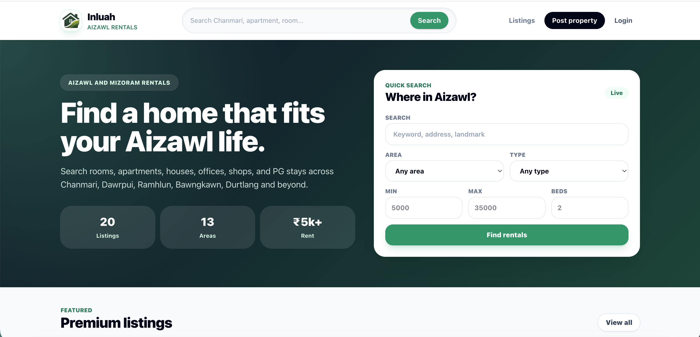

# Inluah

[](https://github.com/thadomaloma/house_rent_app/actions/workflows/ci.yml)

Inluah is a rental property marketplace built for Aizawl and the wider Mizoram
community. It helps tenants discover local rentals while giving owners a simple
way to publish and manage property listings.



## Features

- Search by keyword, locality, property type, rent range, and bedrooms
- Browse houses, apartments, rooms, hostels/PGs, shops, and offices
- Create and manage listings with multiple property photos
- Save favorite properties for later
- Contact property owners through listing inquiries
- Track listing availability, featured status, and view counts
- Role-based experiences for tenants, owners, and administrators
- Admin tools for reviewing, updating, and removing listings
- Responsive interface powered by Hotwire and Tailwind CSS

## Technology

| Area | Technology |
| --- | --- |
| Application | Ruby 4.0.3, Rails 8.1 |
| Database | PostgreSQL |
| Frontend | Hotwire, Turbo, Stimulus, Tailwind CSS |
| Authentication | Devise |
| File uploads | Active Storage, ImageProcessing, libvips |
| Background services | Solid Queue, Solid Cache, Solid Cable |
| Deployment | Docker, Kamal, Thruster |
| Quality and security | Minitest, RuboCop, Brakeman, Bundler Audit |

## Requirements

Install the following before setting up the application:

- Ruby `4.0.3`
- PostgreSQL
- libvips
- Bundler

On macOS with Homebrew:

```bash
brew install postgresql libvips
brew services start postgresql
```

## Local setup

Clone the repository and enter the project directory:

```bash
git clone git@github.com:thadomaloma/house_rent_app.git
cd house_rent_app
```

Install dependencies and prepare the database:

```bash
bundle install
bin/rails db:prepare
```

Start Rails and the Tailwind CSS watcher:

```bash
bin/dev
```

Open [http://localhost:3000](http://localhost:3000).

You can also run the automated setup script, which installs dependencies,
prepares the database, clears temporary files, and starts the development
server:

```bash
bin/setup
```

## Sample data

Load the development seed data:

```bash
bin/rails db:seed
```

> [!WARNING]
> The seed script removes existing users, listings, favorites, and inquiries
> before creating sample records. Use it only with disposable development data.

The seed data provides these local accounts:

| Role | Email | Password |
| --- | --- | --- |
| Administrator | `admin@inluah.test` | `password` |
| Property owner | `owner1@inluah.test` | `password` |
| Tenant | `tenant@inluah.test` | `password` |

These credentials are for local development only.

## Configuration

Local development uses the PostgreSQL databases defined in
`config/database.yml`:

- `house_rental_app_development`
- `house_rental_app_test`

Rails also accepts `DATABASE_URL` when custom database credentials or a remote
database are required.

Production configuration uses encrypted Rails credentials. Keep
`config/master.key`, `.env` files, and `.kamal/secrets` outside version control.
Provide secrets through the deployment environment, including:

| Variable | Purpose |
| --- | --- |
| `RAILS_MASTER_KEY` | Decrypts Rails production credentials |
| `DATABASE_URL` | Overrides the default database connection |
| `HOUSE_RENTAL_APP_DATABASE_PASSWORD` | Password used by the production database configuration |

## Tests and code quality

Run the test suite:

```bash
bin/rails test
```

Run style and security checks:

```bash
bin/rubocop
bin/brakeman --no-pager
bin/bundler-audit
bin/importmap audit
```

GitHub Actions runs the automated test, lint, dependency audit, and security
scan jobs on pushes to `main` and on pull requests.

## Main application routes

| Route | Purpose |
| --- | --- |
| `/` | Homepage and featured listings |
| `/properties` | Browse, search, create, and manage listings |
| `/favorites` | View saved properties |
| `/dashboard` | Owner dashboard |
| `/admin` | Administrative dashboard |
| `/up` | Application health check |

## Deployment

The repository includes a production `Dockerfile` and Kamal configuration.
Before deploying, update `config/deploy.yml` for the target server and registry,
then provide the required secrets through `.kamal/secrets` or the deployment
environment.

```bash
bin/kamal setup
```

Review all production database, host, SSL, storage, and secret settings before
running the first deployment.
